<a href="https://www.ladicodes.dev">
  <picture>
    <source media="(prefers-color-scheme: dark)" srcset="assets/banner-dark.svg">
    
  </picture>
</a>

<h1 align="center">Hey, I'm Ladipo Samuel 👋</h1>

  Most people know me as <b>Ladicodes</b>.

  I'm a Developer Relations Engineer, Blockchain Builder, and Backend Engineer. I've worked with engineering teams at <b>Microsoft</b> and <b>Squad by GTCO</b>, built on <b>Solana</b> through Turbin3, and spent a good part of my journey building tools, writing technical content, and helping developer communities grow.

  I enjoy building things, and making it easier for other developers to build theirs.

  
   
  
  
  

## What I do

  <picture><source media="(prefers-color-scheme: dark)" srcset="assets/cards/focus-build-dark.svg">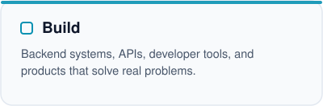</picture>
  <picture><source media="(prefers-color-scheme: dark)" srcset="assets/cards/focus-blockchain-dark.svg">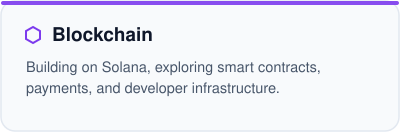</picture>
  <picture><source media="(prefers-color-scheme: dark)" srcset="assets/cards/focus-teach-dark.svg">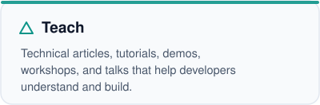</picture>
  <picture><source media="(prefers-color-scheme: dark)" srcset="assets/cards/focus-community-dark.svg">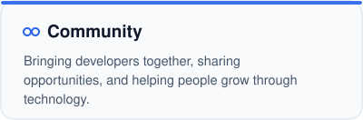</picture>

## Featured projects

  <a href="https://sovra-ecru.vercel.app"><picture><source media="(prefers-color-scheme: dark)" srcset="assets/cards/project-sovra-dark.svg">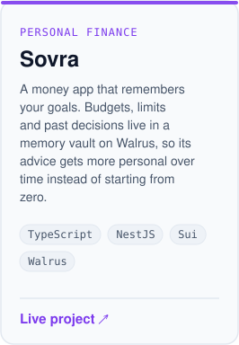</picture></a>
  <a href="https://www.usestakesync.xyz/"><picture><source media="(prefers-color-scheme: dark)" srcset="assets/cards/project-stakesync-dark.svg">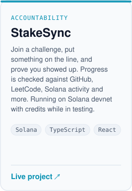</picture></a>
  <a href="https://blockrouter.netlify.app"><picture><source media="(prefers-color-scheme: dark)" srcset="assets/cards/project-blockrouter-dark.svg">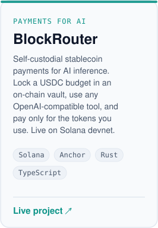</picture></a>

Sovra and BlockRouter are team builds; Sovra came out of the Tatum x Walrus hackathon and BlockRouter is my Turbin3 capstone team's project.

## Open source

<a href="https://github.com/ladicodes/DSA-Solutions-and-Patterns"><picture><source media="(prefers-color-scheme: dark)" srcset="assets/cards/oss-dsa-dark.svg">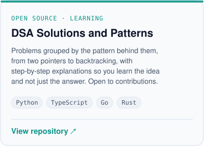</picture></a>

 

## Video tutorials & demos

I build, I write, and I teach. My Docker series breaks one tool down in short videos, with an article for each part.

  <a href="https://x.com/ladicodez/status/2071284719556215067"><picture><source media="(prefers-color-scheme: dark)" srcset="assets/cards/video-docker-1-dark.svg">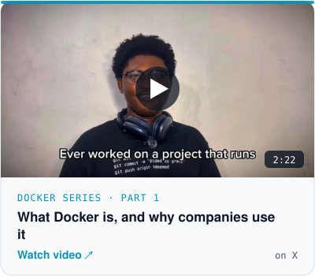</picture></a>
  <a href="https://x.com/ladicodez/status/2073815924365238379"><picture><source media="(prefers-color-scheme: dark)" srcset="assets/cards/video-docker-2-dark.svg">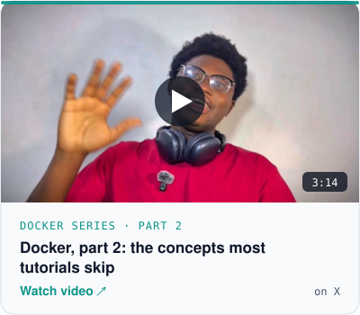</picture></a>

## Technical writing

  <a href="https://dev.to/ladipo_samuel_7cfaa827bf5/building-on-solana-with-turbin3-understanding-the-architecture-first-2fm8"><picture><source media="(prefers-color-scheme: dark)" srcset="assets/cards/article-solana-architecture-dark.svg">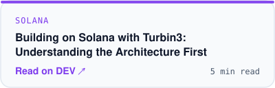</picture></a>
  <a href="https://dev.to/ladipo_samuel_7cfaa827bf5/building-an-spl-token-creating-the-mint-gi7"><picture><source media="(prefers-color-scheme: dark)" srcset="assets/cards/article-spl-mint-dark.svg">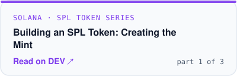</picture></a>
  <a href="https://dev.to/ladipo_samuel_7cfaa827bf5/beyond-crud-9-backend-concepts-every-engineer-should-know-to-build-scalable-and-reliable-systems-4af3"><picture><source media="(prefers-color-scheme: dark)" srcset="assets/cards/article-beyond-crud-dark.svg">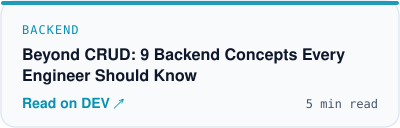</picture></a>
  <a href="https://dev.to/ladipo_samuel_7cfaa827bf5/backend-concepts-i-understand-better-because-of-fintech-2hee"><picture><source media="(prefers-color-scheme: dark)" srcset="assets/cards/article-fintech-dark.svg">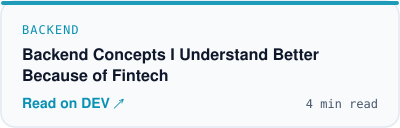</picture></a>

  SPL token series continues with <a href="https://dev.to/ladipo_samuel_7cfaa827bf5/building-an-spl-token-on-solana-adding-metadata-e5f">Adding Metadata</a> and <a href="https://dev.to/ladipo_samuel_7cfaa827bf5/building-an-spl-token-on-solana-minting-tokens-and-understanding-atas-3hpl">Minting Tokens and Understanding ATAs</a> ·
  Docker articles: <a href="https://dev.to/ladipo_samuel_7cfaa827bf5/docker-explained-part-1-understanding-docker-before-writing-your-first-command-3o0o">part 1</a>, <a href="https://dev.to/ladipo_samuel_7cfaa827bf5/docker-explained-part-2-understanding-dockers-architecture-images-containers-1fop">part 2</a>, <a href="https://dev.to/ladipo_samuel_7cfaa827bf5/docker-series-part-3dockerizing-your-first-application-1ji6">part 3</a> ·
  <a href="https://dev.to/ladipo_samuel_7cfaa827bf5">everything on DEV</a>

## Experience & community

<table>
  <tr><td><b>Microsoft</b></td><td>Former Software Engineering Intern. Chosen as lead intern for the cohort.</td></tr>
  <tr><td><b>Squad by GTCO</b></td><td>Backend engineering in fintech, and work on <a href="https://github.com/ladicodes/Squad-Hackademy">Hackademy</a>, Squad's developer education portal.</td></tr>
  <tr><td><b>Turbin3</b></td><td>Solana development program, graduate. Anchor programs for an <a href="https://github.com/ladicodes/assignment_2_escrow">escrow</a>, an <a href="https://github.com/ladicodes/assignment_3_amm">AMM</a>, <a href="https://github.com/ladicodes/assignment_4_token22">Token-2022</a> and <a href="https://github.com/ladicodes/assignment_5_nft_staking">NFT staking</a>.</td></tr>
  <tr><td><b>GDG UNILAG</b></td><td>Team Lead, Publicity &amp; Community.</td></tr>
  <tr><td><b>Speaking</b></td><td>Talk on developer advocacy at TechPulse, mentor and speaker at the Hult Prize, tech panels, and designing and judging hackathon challenges.</td></tr>
</table>

## Tech stack

<table>
  <tr><td><b>Languages</b></td><td>   </td></tr>
  <tr><td><b>Backend</b></td><td>    </td></tr>
  <tr><td><b>Blockchain</b></td><td>   </td></tr>
  <tr><td><b>Frontend &amp; cloud</b></td><td>    </td></tr>
</table>

## Behind the commits

<picture>
  <source media="(prefers-color-scheme: dark)" srcset="assets/stats-dark.svg">
  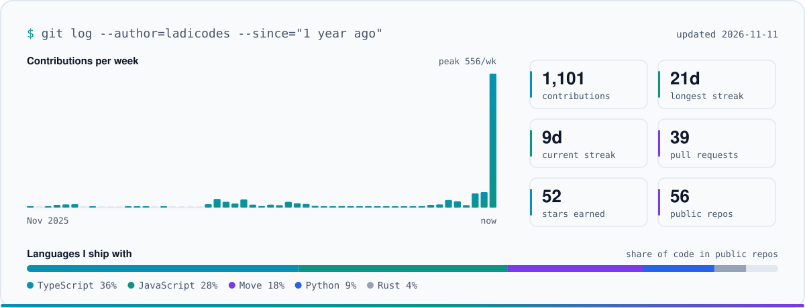
</picture>

Built from my public GitHub data and refreshed daily by a small GitHub Action in this repo.

## Let's build something

If you're building developer tools, working in the Solana ecosystem, or putting together an event and need a speaker, I'd love to hear about it. My X DMs are open, and that's usually the fastest way to reach me.

  <a href="https://www.ladicodes.dev"><b>Portfolio</b></a> ·
  <a href="https://x.com/ladicodez"><b>X</b></a> ·
  <a href="https://www.linkedin.com/in/ladicodes"><b>LinkedIn</b></a> ·
  <a href="https://dev.to/ladipo_samuel_7cfaa827bf5"><b>DEV</b></a>

<i>Happy building 💜</i>

